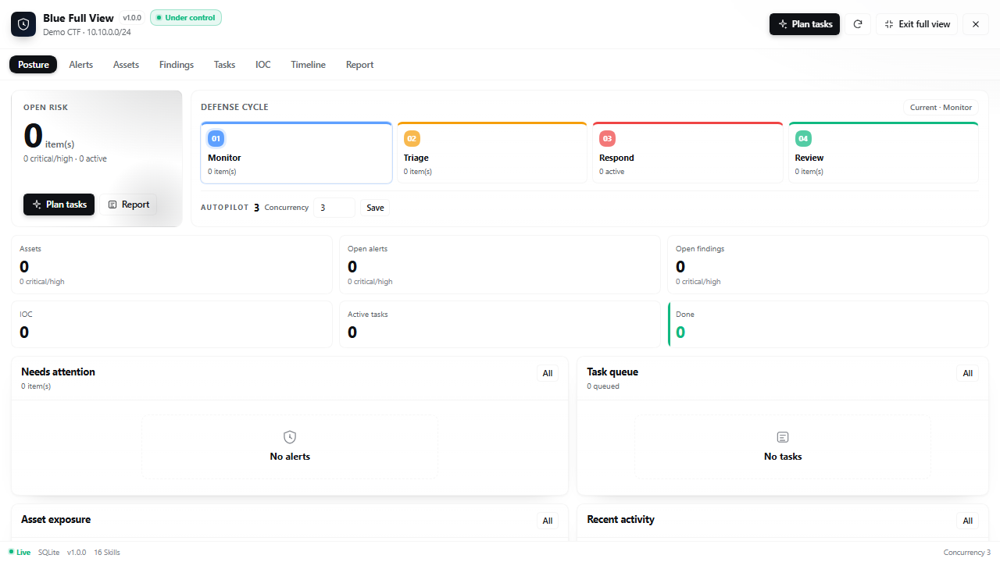
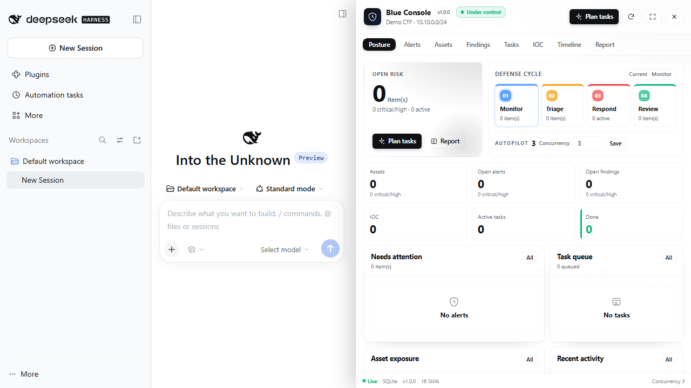

# dsh-blue-team-mode

把 DeepSeek Harness 变成 **CTF 网络攻防蓝队指挥台**：一个防守目标拉起监控值守、情报分析、威胁狩猎、应急响应、取证分析、加固修复六个执行角色；资产、告警、发现、IOC、任务与时间线实时落入本地 SQLite 事实库，并在**独立右侧栏控制台**中可视化，由指挥官按并发名额自主派发任务。

> ⚠️ **仅限已获授权的 CTF 靶场 / 攻防演练 / 自有资产防守使用。**
> 本插件只做防守侧的采集、比对、编排、取证与记录，**不包含任何攻击、漏洞利用或未授权探测代码**。
> 使用者必须确保对目标拥有书面授权，并遵守比赛规则。

---

## 它解决什么问题

手工防守常见的三个问题：

1. **信息散**：告警在 WAF、日志在服务器、样本在桌面、结论在聊天里，复盘时对不上。
2. **派活乱**：指挥官一边盯告警一边自己扫日志，忘了还有哪些资产没看。
3. **没证据**：子智能体说"清掉了"，但库里没有记录，报告写不出来。

本插件用 **一个事实库 + 一个任务队列 + 六个角色预设** 把闭环固定下来：

```
告警/日志/样本
      │
      ▼
┌───────────────┐     plan/next/complete     ┌────────────────┐
│ blue_autopilot │ ─────────────────────────▶ │  subagent 派发  │
│  任务编排器     │ ◀───────────────────────── │  6 个执行角色   │
└───────┬───────┘       结果/证据落库          └────────────────┘
        │
        ▼
┌──────────────────────────────────────────────────────────────┐
│  SQLite 事实库：assets / alerts / findings / iocs / tasks /   │
│  timeline / engagements        （$DSH_HOME/blue/blue.db）     │
└──────────────────────────────────────────────────────────────┘
```

---

## 安装

在 DeepSeek Harness 中把本目录作为 bundle 安装（需要 Full access 或逐次批准）：

```text
plugin_manager action=install_bundle target="C:\Users\86186\Desktop\蓝队防御插件"
```

或使用 CLI（等价）：

```sh
dsh plugin --profile desktop add "C:\Users\86186\Desktop\蓝队防御插件"
```

安装后**重启一次 `dsh web`**，在界面助手栏选择预设 **「蓝队防御模式」**，直接发防守目标即可开工。右侧栏控制台随插件一起加载：会话头部会出现 **「蓝队」** 按钮，右侧栏的引导页里也有 **「蓝队控制台」** 卡片。

> 依赖 Node.js ≥ 22.13（`node:sqlite`）。插件不下载、不安装任何外部工具；用 `blue_preflight` 查看本机缺什么。

---

## 快速开始

在「蓝队防御模式」会话里发：

```text
防守目标：example-ctf 靶场，范围 10.10.0.0/24 和 *.example.test。
先盘点资产、接入告警，然后自主派活。
```

指挥官会：

1. `blue_engagement_open` 绑定目标；
2. `blue_preflight` 检查工具；
3. 派 `monitor` 盘点资产、接入告警；
4. `blue_autopilot action=cycle` 生成并领取任务；
5. 用 `subagent` + `agent_preset` 派给对应角色；
6. 子智能体回报后查库核对，`complete` 回收，再进入下一轮。

也可以手动指挥：

```text
看一下现在什么态势
把这条 critical 告警转成应急任务
对 10.10.0.5 做失陷痕迹核查
生成报告并写到文件
```

---

## 独立控制台（右侧常驻面板）

这是一个挂在 `shell.overlay` 上的独立右侧面板，不再是右侧栏里的文件 tab：有自己的标题栏、页签、底部状态栏，可拖拽调宽，也可以全屏。原生右侧栏打开时面板会自动让位隐藏，关闭原生右侧栏后恢复。界面按红队控制台的设计语言重做：品牌头、状态胶囊、指标卡、防守阶段、双栏处置区、可滚动表格与任务结论弹窗，全部使用 DSH 主题 token。

- **入口**：会话头部右侧的 **「蓝队」** 按钮，一键打开/收起。
- 左下角的常驻入口已取消；全面浏览只从面板标题栏的全屏按钮进入。

面板默认打开；拖拽左边界可调宽，点标题栏的全屏按钮进入全面浏览，`Esc` 退出。控制台页签：

| 页签 | 内容 | 可执行操作 |
| --- | --- | --- |
| 态势 | 资产/告警/发现/IOC/任务统计、关键告警、任务队列 | 规划任务、刷新、调整并发、生成报告 |
| 告警 | 级别、来源、状态、时间 | 确认、标误报、转处置任务 |
| 资产 | 关键级别、地址、端口、服务、状态 | 新增/更新资产 |
| 发现 | 严重级别、类型、状态 | 标记已修复、接受风险 |
| 任务 | 优先级、角色、状态、任务书 | 领取（生成 subagent 任务书）、完成、阻塞 |
| IOC | 类型、值、置信度、来源 | 新增 IOC |
| 时间线 | 时间、主体、动作、对象、详情 | 查看 |
| 报告 | 从事实库生成的 Markdown | 生成/刷新 |

**领取任务**会把任务置为 `dispatched`，并弹出可直接复制的完整任务书（含 `agent_preset`）。控制台本身不能代替 Agent 调用 `subagent`，但把任务书交给指挥官即可继续自主循环。

Host 半侧通过 `POST /blue/api` 提供同源 JSON 桥接（Origin/Host 校验），读写的仍是 `ctx.blueTeam` 那一份 SQLite；浏览器侧不直接碰数据库。

会话与目标的绑定会镜像到 `$DSH_HOME/blue/session-bindings.json`，控制台据此显示当前会话对应的防守目标；没有绑定时回退到最近一个活跃目标。

### 全面浏览

和红队一致：

- 桌面客户端用同窗全屏 overlay；
- 普通 Web 优先打开新窗口，URL 带 `#blue-full`；
- 标题切为「蓝队全面浏览」，右上角显示「退出全面浏览」；
- `Esc` 退出；全屏时隐藏拖拽边界，内容铺满窗口。





---

## 六个执行角色

| agent_preset | 角色 | 主要职责 | 默认优先级 |
| --- | --- | --- | --- |
| `blue-worker-monitor` | 监控值守 | 告警研判、可用性、首轮止血 | P0/P1 |
| `blue-worker-intel` | 情报分析 | IOC、检测规则、误报评估 | P2 |
| `blue-worker-hunt` | 威胁狩猎 | WebShell、横向、持久化、外带 | P1/P2 |
| `blue-worker-ir` | 应急响应 | PICERL、隔离、清除、恢复 | P0/P1 |
| `blue-worker-forensics` | 取证分析 | 磁盘/内存/日志/样本、时间线 | P1/P2 |
| `blue-worker-hardening` | 加固修复 | 修入口、收敛暴露面、补检测 | P1/P3 |
| `blue-worker` | 全工具执行 | 不确定角色时的兜底 | 按任务 |

执行角色是**叶子节点**：预设里没有 `subagent` / `workflow` / `ralph`，需要别的角色时只能写 `needs:` 交给指挥官。

---

## 工具（29 个）

### 目标与预检

| 工具 | 作用 |
| --- | --- |
| `blue_engagement_open` | 建立/复用防守目标并绑定当前会话（子智能体继承） |
| `blue_session_info` | 查看当前绑定、父会话链、是否子智能体 |
| `blue_scope_check` | 检查 IP/域名/URL 是否在防守范围 |
| `blue_preflight` | 工具链与环境变量自检，缺什么给替代方案 |

### 资产与告警

| 工具 | 作用 |
| --- | --- |
| `blue_asset_add` | 登记/更新资产（域名/IP/端口/服务/关键级别） |
| `blue_asset_query` | 查询资产清单 |
| `blue_alert_ingest` | 接入告警（字段或 JSON 数组，自动去重） |
| `blue_alert_list` | 按状态/级别/来源过滤 |
| `blue_alert_triage` | 研判告警，可一键转处置任务 |

### IOC 与发现

| 工具 | 作用 |
| --- | --- |
| `blue_ioc_add` | 登记 IOC（ip/domain/url/hash/ua…） |
| `blue_ioc_list` | 查询 IOC |
| `blue_ioc_check` | 用 IOC + 内置特征扫描文本/日志 |
| `blue_finding_add` | 登记漏洞/暴露面/失陷痕迹，带证据与建议 |
| `blue_finding_update` | 更新发现状态/级别/证据/建议（修复闭环） |
| `blue_finding_list` | 查询发现 |

### 任务与自主派发

| 工具 | 作用 |
| --- | --- |
| `blue_task_create` | 手动建任务（角色/优先级/简报/验收；high 自动进入待审批） |
| `blue_task_update` | 更新状态与结论（done/blocked/…；不能绕过审批直接派发 high） |
| `blue_task_list` | 查看队列（含 risk_level/approved_by） |
| `blue_task_approve` | **人工放行** high 待审批任务，写 approved_by/at 与 timeline |
| `blue_autopilot` | **核心编排器**：`status` / `plan` / `next` / `cycle` / `complete` / `set_slots` |

### 风险闸与审批

- `low`：只读排查、日志确认、IOC 提取、报告；
- `medium`：非破坏性核对、可回滚加固建议；
- `high`：隔离主机、删除/隔离文件、改防火墙、杀进程、禁用账号、重置凭据、改启动项/内核参数。

`high` 任务只能进入 `pending_approval`，不会出现在 `cycle` 的 `dispatch` 里。控制台点「批准」，或由指挥官调用 `blue_task_approve`，才会变成 `queued`；审批会写 `approved_by`、`approved_at`、`approval_note` 和 timeline 的 `approval` 事件。

自动派发还带轮次上限和冷却窗口，避免“任务 → 新告警 → 再派任务”自转。

`blue_autopilot action=cycle` 会返回：

```json
{
  "dispatches": [
    {
      "task_id": "TSK-...",
      "role": "ir",
      "risk_level": "high",
      "requires_approval": true,
      "approved_by": "console",
      "approved_at": "2026-...",
      "agent_preset": "blue-worker-ir",
      "dispatch": {
        "tool": "subagent",
        "arguments": {
          "description": "应急响应：处置告警：...",
          "prompt": "【角色职责】...【任务】...【验收标准】...",
          "agent_preset": "blue-worker-ir"
        },
        "task_id": "TSK-...",
        "risk_level": "high",
        "requires_approval": true,
        "approved_by": "console",
        "approved_at": "2026-..."
      }
    }
  ],
  "remaining_slots": 2
}
```

指挥官原样调用 `subagent` 即可；任务书已经自包含（目标、已知事实、证据要求、验收标准、`needs:` 格式）。

### 分析、处置与报告

| 工具 | 作用 |
| --- | --- |
| `blue_timeline` | 记录/查看事件时间线 |
| `blue_playbook_list` | 列出 16 个随包蓝队技能 |
| `blue_log_scan` | 日志/文本攻击特征 + IOC 扫描 |
| `blue_artifact_triage` | 样本只读初筛：哈希/类型/熵/字符串/可疑 API |
| `blue_hardening_check` | 本机加固基线快检（端口/防火墙/账号/SSH/审计） |
| `blue_containment_plan` | 按事件类型生成处置剧本 |
| `blue_report` | 从事实库生成 Markdown 报告，可写文件 |
| `blue_defense_status` | 一眼看态势与下一步建议 |
| `blue_tool_catalog` | 外部蓝队工具目录（用途/示例） |

---

## 自主派发机制

`blue_autopilot` 的任务来源：

1. **未闭环告警**：critical → `ir`，high → `hunt`，其余 → `monitor`；
2. **未闭环高危发现**：WebShell/RCE/上传类 → `ir`，其余 → `hardening`；
3. **重点资产覆盖**：critical/high 且没有发现的资产 → `hunt` 失陷痕迹核查；
4. **基线缺口**：没资产 → `monitor` 盘点；没 IOC → `intel`；没告警 → `monitor` 接日志；始终有 `hardening` 基线项。

去重规则：同标题任务未关闭前不重复创建，避免自主循环刷爆队列。

风险闸：

- `high` 任务由 `ir`/`hardening` 的隔离、删除、防火墙、杀进程、禁用账号、改启动项等动作触发；
- 高风险任务只进入 `pending_approval`，`cycle/next` 不会派发；
- 控制台「批准」或 `blue_task_approve` 才转 `queued`，并写入 `approved_by/approved_at/approval_note` 与 timeline `approval`；
- `cycle` 有 `max_rounds`（默认 12）与 `cooldown_sec`（默认 30）限制，防止任务→告警→再派任务自转。

并发规则：

- 默认 3（`blue_autopilot action=set_slots slots=3`，上限 8）；
- `cycle` 会先读 `ctx.subagents.listChildren` 的真实运行数，再按剩余名额领取；
- 名额满时返回 `slots_full`，指挥官应等待而不是硬塞。

> **边界说明**：`blue_autopilot` 负责"计划 + 领取 + 生成可直接调用的 subagent 参数 + 回收"；
> 真正的 `subagent` 调用由模型执行（DSH 的工具注册表不允许插件代替 Agent 发起委派）。
> 因此"自主"指的是循环与队列自动推进，而不是绕过模型直接开进程。

---

## 数据模型

数据库：`$DSH_HOME/blue/blue.db`（WAL）。

| 表 | 内容 |
| --- | --- |
| `engagements` | 防守目标、范围、状态 |
| `assets` | 资产（kind/address/port/service/criticality/owner/tags/evidence） |
| `alerts` | 告警（severity/source/confidence/task_id/status/assignee/note/raw，指纹去重） |
| `findings` | 发现（severity/category/confidence/source/task_id/cve/evidence/recommendation/status） |
| `iocs` | IOC（type/value/confidence/source/note/first_seen/last_seen，(engagement,type,value) 唯一） |
| `tasks` | 任务（role/priority/status/risk_level/requires_approval/approved_by/approved_at/scope/constraints/expected_output/brief/acceptance/result/时间戳） |
| `timeline` | 时间线（at/actor/action/target/detail） |
| `meta` | 并发上限等运行配置 |

所有写入都通过 `blue_*` 工具；智能体不直接写 SQL。

### 判定层

`lib/judge.js` 是唯一状态机与未闭环判定来源：

- 任务合法迁移表：`queued / pending_approval / dispatched / running / done / blocked / cancelled`；
- 告警未闭环：`open / investigating`；
- 发现未闭环：`open`；
- `postureOf()` 统一输出 `stable / warning / critical`；
- store、plan、控制台统计都读同一套枚举，不在各角色里散写 if。

### TaskSpec

`lib/taskspec.js` 定义 `TASK_SPEC_SCHEMA` 与统一渲染：

- `markdown`：控制台「领取」/ autopilot 的 `prompt`；
- `json`：dispatch 里的 `task_spec`，供子智能体/审计消费；
- 字段：`task_id/role/title/priority/risk_level/requires_approval/approved_by/scope/constraints/expected_output/acceptance/brief`；
- `TaskSpec` 的 `scope/constraints/expected_output` 同时写进 tasks 表，避免只存在于 prompt。

### 合规闸门

```sh
node scripts/install-hooks.mjs
node scripts/check-compliance.mjs --selftest
```

`pre-commit` 会扫描暂存区中的 GitHub token、AWS key、私钥等模式，并检查 `DISCLOSURE` 存在；`--selftest` 会同时确认 hook 文件与 `core.hooksPath` 确实接在提交路径上。

---

## 随包技能（16 个）

`blue-setup`、`incident-response`、`log-analysis`、`webshell-hunt`、`threat-hunting`、`host-forensics`、`memory-forensics`、`malware-triage`、`network-forensics`、`hardening`、`ioc-management`、`ctf-defense`、`reporting`、`containment`、`web-attack-triage`、`cloud-k8s-defense`。

技能同步到 `$DSH_HOME/blue/skills`，由预设的 `skill-filesystem` 发现；用户自己的 `$DSH_HOME/skills` 优先级更高，可覆盖同名技能。

---

## 控制台 E2E

`scripts/test-ui-e2e.mjs` 用本机 Chrome + CDP 真实点击控制台「批准」按钮，验证：

1. 点击确实发出 `approveTask` 请求；
2. Host API 把任务从 `pending_approval` 改成 `queued`；
3. `approved_by/approved_at` 落库；
4. UI 任务行不再显示批准按钮，并显示 queued/审批人。

前置：DSH Web 已加载最新插件并保持运行。

```sh
BLUE_E2E_URL='http://127.0.0.1:PORT/?token=...' npm run test:e2e
```

需要本机 Chrome/Chromium；可用 `CHROME_PATH` 指定路径。脚本不依赖 Playwright，不会下载浏览器，测试结束会关闭自己启动的 Chrome 并清理临时 profile。

---

## 配置

`cordis.patch.yml` 中事实库默认根目录：

```yaml
- id: blue-mode-store
  name: dsh-blue-team-mode/store
  config:
    root: !!js dshHomePath('blue')
```

可用环境变量覆盖：`BLUE_HOME`（数据根）、`DSH_HOME`（默认 `~/.dsh`）。

执行角色的工具裁剪在 `lib/tools.js` 里按 `profile` 实现；改 `presets/blue/worker.cordis.yml` 后跑：

```sh
node scripts/build.mjs
```

重新生成 `cordis.patch.yml`（不要手改生成区）。

---

## 验证与排障

- 安装后 `Config.listConfigs name=@deepseek-ai/dsh-agent-preset` 应出现 `preset-blue` 与 `preset-blue-worker*`，状态为 `schema` 而不是 `broken`。
- 新模式列表里应出现「蓝队防御模式」；子预设显示名带「由主会话自动选用」。
- 会话内 `blue_defense_status` 应返回版本、数据目录、技能数量。
- 独立面板：会话头部出现「蓝队」；刷新后右侧常驻面板默认打开，可拖拽左边界调宽，标题栏可进入全面浏览。左下角不再有入口。
- 控制台接口：`POST /blue/api` 应返回 JSON；404/403 时检查 `blue-mode-ui` 行是否激活、页面是否同源。
- 控制台空白：先在会话里 `blue_engagement_open`，或在面板空态新建目标；`session-bindings.json` 应存在。
- 工具不出现：确认使用的是蓝队预设（工具行只挂在预设平面，不会污染其它会话）。
- 数据库 locked：确认没有多个 Host 同时写同一 `blue.db`；WAL + busy_timeout 已启用。
- 预设激活失败：看 `$DSH_HOME/logs` 或 `dsh --profile desktop --dump-config`；常见原因是 `dsh-blue-team-mode/tools` 包未装进 profile。

---

## 限制

- 不捆绑任何外部工具（nmap/tshark/yara/volatility 等），只检查与编排；需要用户自行准备。
- `blue_hardening_check` 只读执行少量系统命令，跨平台覆盖有限；结果需人工复核。
- 日志/样本扫描是特征匹配，不能替代深度取证；高熵/加壳样本需沙箱或内存分析。
- 任务"自主"推进依赖模型调用 `subagent`；插件不绕过 DSH 的委派与审批机制。控制台可以规划、领取、完成、阻塞任务，但不能代替 Agent 发起委派。
- SQLite 事实库是单机本地库，不做多机同步；多人协作请各自导出报告合并。

---

## License

MIT。见 `LICENSE`（如未随包提供，按 MIT 使用）。使用前请阅读 `DISCLOSURE`。
